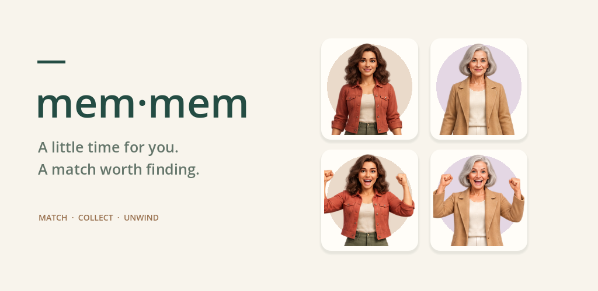
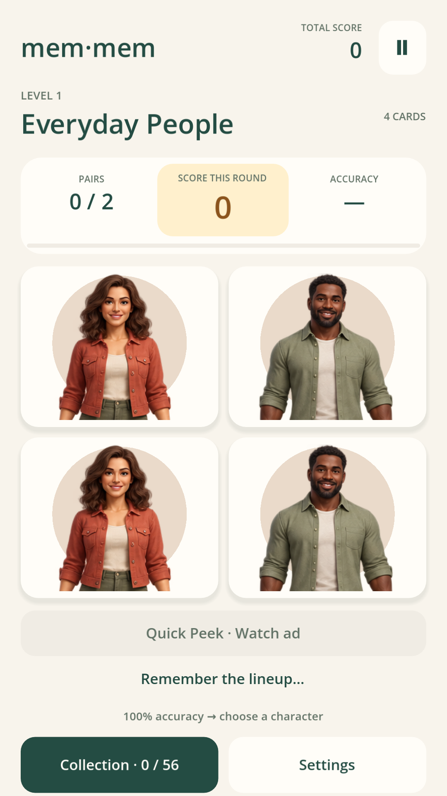
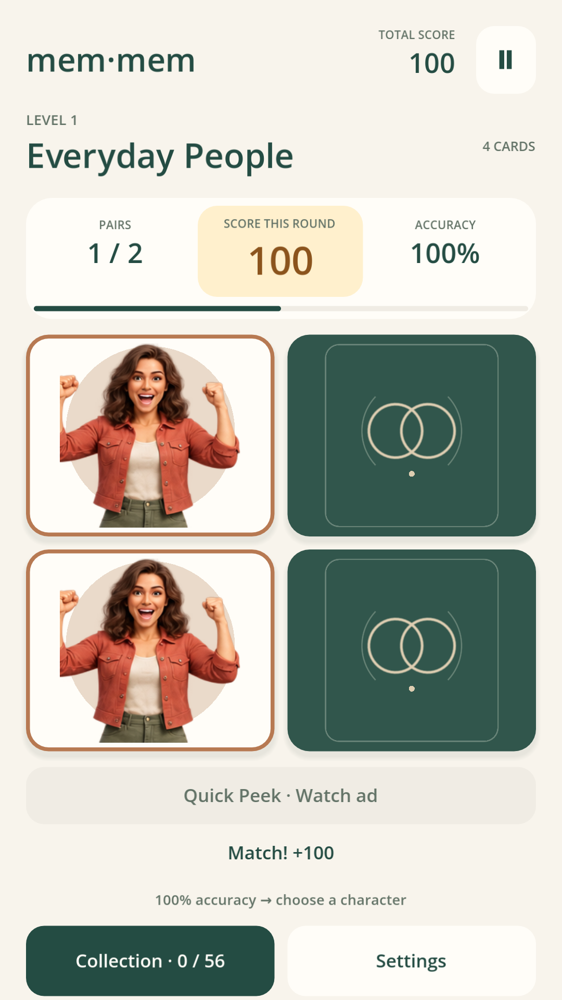
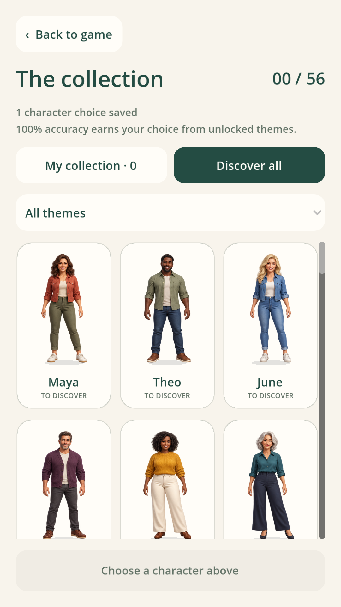
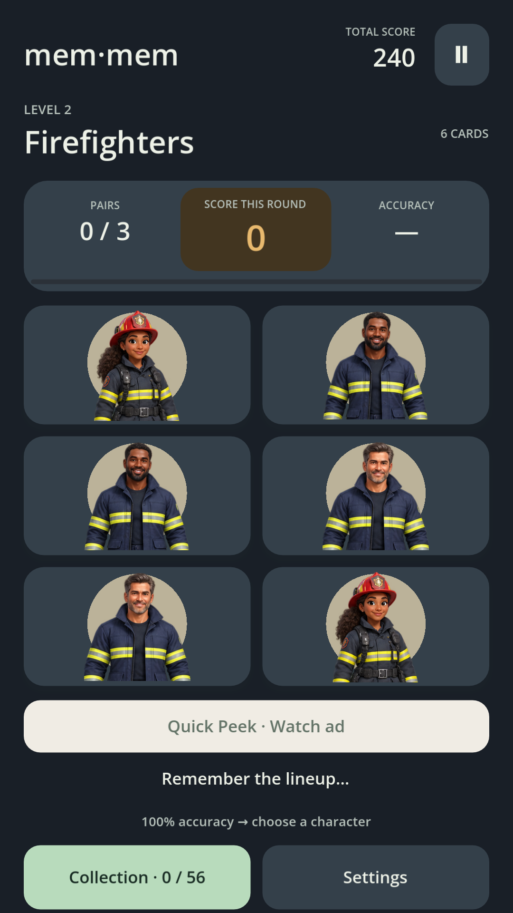

<h1 align="center">Mem-Mem</h1>

<p align="center"><b>A matching game for grown-ups. No timer, no lives, no pressure.</b><br>
Flip cards, find the pairs, watch the cast cheer, and build a collection of 56 characters at your own pace.</p>

<p align="center">
  <a href="https://play.google.com/store/apps/details?id=io.github.vincentaz.memmem"><b>Get it on Google Play</b></a> ·
  <a href="docs/architecture.md">How it works</a> ·
  <a href="docs/privacy-policy.md">Privacy policy</a>
</p>

<p align="center">
  
  
  
  
  
</p>

<p align="center"></p>

Mem-Mem is a portrait-mode Android memory game built in Godot 4 and GDScript. It is live on Google Play
(United States) as a free game with an optional one-time **Mem-Mem Plus** purchase. There is no account,
no analytics, no runtime AI and no leaderboard: your progress and your collection live on your phone.

This repository is the whole thing: the game, the Android consent extension, the purchase-verification
service, the build and test scripts, the store assets and every setup document written along the way.

## How you play

| Do this | And this happens |
|---|---|
| Watch the shuffle | The cards land, show their faces for half a second, then flip over. Positions never move. |
| Tap two cards | A match: both characters light up, celebrate and walk off. A miss: both flip back. |
| Clear the board | The whole cast walks back in and cheers around your score. Nothing advances until you tap **Next level**. |
| Finish with 100% accuracy | You earn one **character choice**. Open the collection, pick any character from an unlocked theme, and collect it. |
| Need another look? | **Quick Peek** shows the remaining cards for half a second, once per board. Free players earn it by watching a rewarded ad; Plus includes one per board. A peek never costs accuracy. |
| Close the app mid-board | Everything is saved: the exact layout, matched pairs, attempts, score, collection and settings. |

Boards follow a repeating rhythm of **4, 6, 8, 6, 12, 4, 8, 6, 16, 4, 8, 6** cards, so a hard board is
always followed by an easy one. Each pair is worth 100 points plus an accuracy bonus of up to 20 per pair.
Mismatches never take points away.

## A look around

<table>
<tr>
<td width="25%"><br><sub><b>Match pairs.</b> Every visible character is one exact pair.</sub></td>
<td width="25%"><br><sub><b>Find a match.</b> Matched characters switch to a delighted pose and depart.</sub></td>
<td width="25%"><br><sub><b>Discover characters.</b> Browse all 56, filter by theme, spend a choice.</sub></td>
<td width="25%"><br><sub><b>Dark mode.</b> Four backgrounds, light or dark, reduce motion, sound on or off.</sub></td>
</tr>
</table>

**Seven themes, eight characters each.** Everyday People, Firefighters, Aliens and Golden Years are free.
Woodland Crew, Snack Squad and Mythical Misfits come with Plus. Unlocked themes rotate from board to
board with a mixed cast every fifth level, or pin a favorite theme in Settings. Owned characters get gold
frames and animated cheering poses in **My collection**; tap one and it dances or waves.

**Mem-Mem Plus** is a single $1.99 purchase: no ads, one Quick Peek on every board, and the three extra
themes. Plus unlocks characters to *earn*, it does not hand them over. Purchases are verified server-side
and keep working offline for up to seven days between checks.

## Under the hood

| Part | What it is |
|---|---|
| `game/gameplay/` | Seeded board generation, matching and scoring rules, progress, the character catalog, and crash-safe saves (two alternating snapshots with SHA-256 checksums) |
| `game/demo/` | The game screen: shuffle, preview, flips, walking departures, the cheering line-up, and Android lifecycle handling |
| `game/presentation/` | Shared styles, collection cards, backgrounds, audio, atlas regions and match effects |
| `game/services/` | One interface for billing, ads and consent with a simulated implementation for desktop and debug builds, and native adapters for the store build |
| `game/assets/` | Generated character atlases (24 sheets, transparent PNG) and original sound effects |
| `game/tests/` | Deterministic rule tests, service scenarios, a production-config smoke test and a rendered scene smoke test |
| `android/consent/` | A small Java extension that runs Google's UMP consent flow and privacy-options form |
| `server/` | The purchase verifier for Cloud Run: Node 22, no npm dependencies. Verifies and acknowledges Play purchases, issues RSA-signed installation-bound receipts, and redeems the reusable reviewer access code |
| `scripts/` | Checksum-pinned downloads of the engine, templates, JDK and Android SDK into `.tools/`; debug and signed store builds; emulator, validation and smoke commands |
| `store-assets/` | The Play icon, feature graphic, screenshots and `app-ads.txt` source |
| `docs/` | Architecture, store setup, account checklist, cloud deployment, data safety, privacy policy, asset provenance and validation records |

Some design points worth knowing:

- **Animation never decides anything.** Rules commit matches and scores before any tween runs; a generation
  counter stops a stale callback from touching a later board.
- **Entitlements fail closed.** The app trusts only a receipt signed by the verifier, bound to the
  installation and a nonce, and expiring after seven days. Edited ownership flags and copied receipts are
  rejected; refunds are picked up on the next check.
- **Debug and store builds are different exports.** Debug builds simulate purchases and use Google's demo ad
  units. The store build has no development lab at all, and `build_store.sh` refuses to run until real
  AdMob IDs, a privacy URL, signing keys and a verifier URL are configured.
- **Ads are opt-in and non-personalized.** Free players explicitly choose to watch a rewarded ad for a peek;
  nothing auto-plays. The app requests non-personalized ads and honors the UMP privacy-options form.

## Run it

Linux x86_64 with Python 3.12+, Node.js 22+, `curl`, `ripgrep` and the usual OpenGL runtime libraries.
Everything else is downloaded into the ignored `.tools/` directory; your system Java and SDKs are left alone.
Budget 12–16 GB for the engine, templates, Android SDK, build caches and the optional emulator.

```bash
./scripts/setup.sh          # pinned engine, export templates, JDK 17, Android CLI, native plugins
./scripts/validate.sh       # server, store-build, catalog, audio and headless game tests
./scripts/run.sh            # play on the desktop (add --editor to open the Godot editor)
```

### Build for Android

```bash
./scripts/build_android.sh                       # debug APK in build/mem-mem-debug.apk
source scripts/env.sh
adb -s YOUR_DEVICE_SERIAL install -r build/mem-mem-debug.apk
./scripts/share_android.sh                       # or serve the APK to testers over the LAN
./scripts/emulator.sh                            # or boot the dedicated test emulator
```

The debug APK runs on Android 8+ (API 26), targets API 36 and ships arm64-v8a and x86_64 libraries.
It uses simulated purchases and demo ads and is signed with a local debug key: never publish it.

The signed store bundle needs a configuration file that is not in the repository. Start from
[`docs/store-config.example.json`](docs/store-config.example.json), then:

```bash
./scripts/build_store.sh .tools/store/config.json --check   # lists every missing input
./scripts/build_store.sh .tools/store/config.json           # signed AAB in build/mem-mem-store.aab
```

[Store setup](docs/store-setup.md) walks through the Play Console, AdMob, privacy policy and
Cloud Run steps; [cloud deployment](docs/cloud-deployment.md) records how the verifier is hosted.

### Tests

| Command | Checks |
|---|---|
| `./scripts/validate.sh` | `node --test` on the verifier, Python tests for the store build, catalog and audio checks, headless Godot rule and service tests, production-config smoke |
| `./scripts/smoke_desktop.sh` (or `xvfb-run -a ./scripts/smoke_desktop.sh`) | Drives real pointer input through the rendered scene: full board rhythm, held results, reduced-motion poses, 16-card touch targets, collection animation, rewarded-ad failure and success paths, Plus restrictions. Writes screenshots to `build/screenshots/` |
| `python3 scripts/smoke_android.py --reset-test-progress` | The same journey on the dedicated test emulator, using positions exported by the desktop smoke |
| `python3 scripts/smoke_collection.py` | Installs the APK on the emulator and spends one test choice |

Automated tests use separate save files and a fake store, so your own progress is never touched.
Validation records for each milestone are in [`docs/validation*.md`](docs/validation.md).

## Art and sound

The character atlases are generated images, copied unchanged with their alpha; the prompts and
provenance of every sheet are in [`docs/character-art-prompts.json`](docs/character-art-prompts.json).
Portraits, walking cutouts and cheering poses all reuse the same unmodified art. Sound effects are
original, and the three crowd reactions are derived from two CC0 recordings. See
[asset credits](docs/asset-credits.md).

## License

The code is open source under the [MIT license](LICENSE). The Mem-Mem name, the Google Play listing, the
generated character artwork and the store assets are not part of that grant; please use your own name and
art if you publish a fork.
