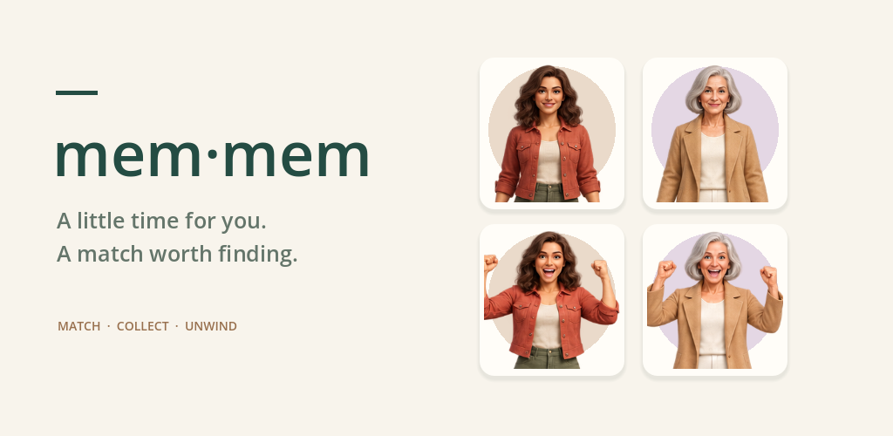
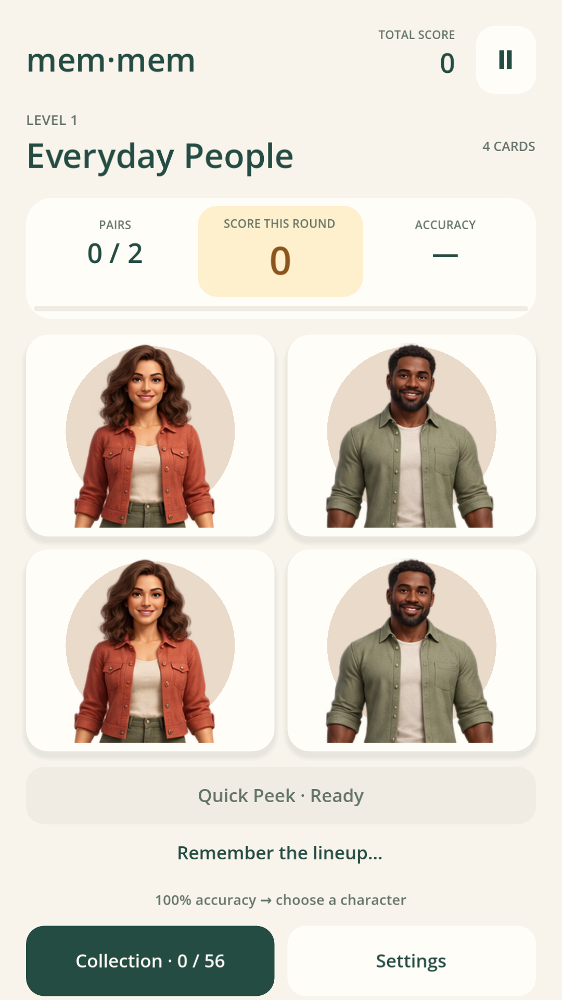
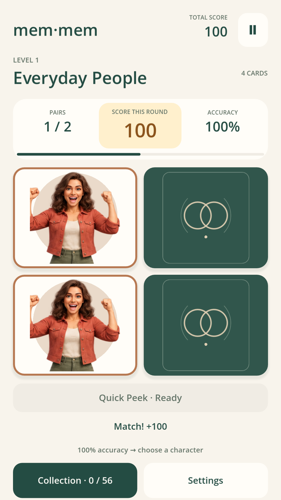
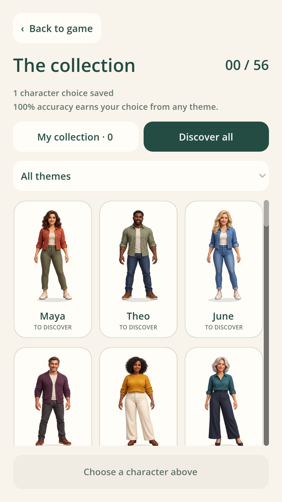
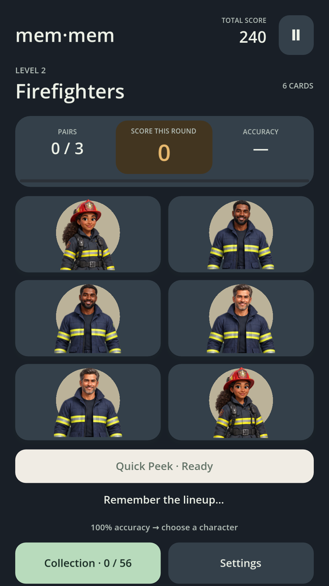

<h1 align="center">mem·mem</h1>
<p align="center"><strong>Small boards. Big personalities. Nothing to buy.</strong><br>
A memory game for grown-ups—with room to breathe and 56 characters to meet.</p>
<p align="center">
  
  
  
  
  
  
</p>
<p align="center">
  <a href="#a-little-look-around">Take a look</a> · <a href="#meet-the-whole-cast">Meet the cast</a> · <a href="#play-from-source">Play from source</a> · <a href="docs/free-edition.md">Free edition notes</a>
</p>
<p align="center"></p>

Flip two cards. Find a pair. Watch the characters celebrate and wander off the board. Clear the last pair and the whole cast returns to cheer you on.

**Free to download and use. Every feature included. No ads, purchases, subscriptions, or account.** All seven themes are available from the start, and every board includes one Quick Peek. No internet connection, receipts, or store checks are needed to keep playing.

No countdown. No lives to refill. No streak you have to protect. Just a satisfying little board and your next discovery.

> **About Google Play:** this repository contains the free edition. An older version already installed from Google Play may still use the previous Plus/ad model until a new signed build is uploaded and released. The [existing listing](https://play.google.com/store/apps/details?id=io.github.vincentaz.memmem) is separate from the source changes here.

## A little look around

<table>
<tr>
<td width="25%"><br><sub><b>Find a familiar face.</b> Every character has one exact match.</sub></td>
<td width="25%"><br><sub><b>Enjoy the little wins.</b> Matched characters celebrate before leaving.</sub></td>
<td width="25%"><br><sub><b>Meet the whole cast.</b> Browse 56 characters and choose who joins your collection.</sub></td>
<td width="25%"><br><sub><b>Settle in.</b> Light or dark, four backgrounds, your pace.</sub></td>
</tr>
</table>

Existing screenshots show earlier builds; any historical Plus wording no longer describes this source edition.

## Simple to start. Lovely to come back to.

| Your move | The little payoff |
| --- | --- |
| Watch the shuffle | Cards settle into their final positions, reveal for half a second, then turn over. |
| Tap two cards | A match lights up and celebrates. A miss flips back so you can try again. |
| Need another look? | **Quick Peek** reveals the remaining cards for half a second, once per board, free and offline. |
| Clear the board | The cast returns to cheer. Take your time: the next board waits for your tap. |
| Finish with 100% accuracy | Earn one character choice. Pick an uncollected character from **any** theme. |
| Take a break | Your exact board, matched pairs, score, collection, and settings are saved. |

Boards follow a gentle rhythm of **4, 6, 8, 6, 12, 4, 8, 6, 16, 4, 8, 6** cards. A bigger challenge is followed by an easier board. Each pair earns 100 points plus an accuracy bonus of up to 20 per pair. A mismatch never takes points away, and a Quick Peek never costs accuracy.

## Meet the whole cast

**Seven themes. Eight characters each. All included.**

| Everyday People | Firefighters | Aliens | Golden Years |
| --- | --- | --- | --- |
| Familiar faces | Everyday heroes | Visitors with personality | A little more life experience |

| Woodland Crew | Snack Squad | Mythical Misfits |
| --- | --- | --- |
| Forest friends | A very lively snack break | Creatures with character |

Themes rotate between boards, with a mixed cast every fifth level. Pin a favorite in Settings whenever you want. Collected characters get gold frames and animated cheering poses—tap one and it dances or waves.

All characters are available **to earn**. Perfect boards and your own choices still build the collection; removing payment does not erase the game’s sense of discovery.

## Play from source

The game is Godot 4.7.2 and GDScript. You can open `game/project.godot` in the matching Godot editor and play on a desktop without Android tools. There is no backend to run.

For the scripted Linux x86_64 toolchain, you need Python 3.12+, `curl`, `ripgrep`, and the usual OpenGL runtime libraries. Setup downloads pinned engine, JDK, templates, and Android tools into `.tools/`.

```bash
git clone https://github.com/VincentAZ/Mem-Mem.git
cd Mem-Mem
./scripts/setup.sh                 # review the Android SDK licenses during setup
./scripts/validate.sh              # rules, saves, assets, build config, scene smoke
./scripts/run.sh                   # play; add --editor to open the editor
```

### Put it on Android

```bash
./scripts/build_android.sh
source scripts/env.sh
adb -s YOUR_DEVICE_SERIAL install -r build/mem-mem-debug.apk
```

The debug APK is `build/mem-mem-debug.apk`, targets API 36, supports Android 8+ (API 26), and includes arm64-v8a and x86_64. **It has the full free feature set.** There are no demo ads, simulated purchases, or advertising consent screens.

For a signed Google Play bundle, copy [`docs/store-config.example.json`](docs/store-config.example.json), set the version, and provide the upload-keystore environment variables described in [store setup](docs/store-setup.md):

```bash
./scripts/build_store.sh .tools/store/config.json --check
./scripts/build_store.sh .tools/store/config.json
```

The AAB is written to `build/mem-mem-store.aab`. Signing is the only external credential requirement: no AdMob IDs, billing products, verifier URL, receipt key, or cloud service. A Play Console release remains a separate publishing step.

## Thoughtful beneath the surface

| Where | What happens there |
| --- | --- |
| `game/gameplay/` | Seeded board generation, matching, scoring, the full catalog, earned collections, and save validation |
| `game/demo/` | Shuffle, preview, flips, departures, cheering, Quick Peek, and Android lifecycle handling |
| `game/presentation/` | Collection cards, shared styles, backgrounds, sound, atlas regions, and celebrations |
| `game/assets/` | Character atlases, transparent artwork, and sound effects |
| `game/tests/` | Deterministic gameplay and migration tests, free-edition scene checks, and pointer-driven smoke tests |
| `scripts/` | Checksum-pinned setup, debug and signed builds, APK auditing, emulator tools, and validation |
| `store-assets/` | Icon, feature graphic, and screenshots |

**Your progress comes first.** Two alternating save snapshots carry SHA-256 checksums. Gameplay commits before animation runs, and stale animation callbacks cannot change a later board. Existing saves keep their board, score, collected characters, and earned choices; no purchase migration or reset is needed.

**Offline means offline.** The game exports without internet or network-state permissions. Ad SDKs, billing plugins, consent extensions, and the old verification server have been removed.

### Check a change

```bash
./scripts/validate.sh
# With a desktop display, or under xvfb-run:
./scripts/smoke_desktop.sh
# With the dedicated test emulator:
python3 scripts/smoke_android.py --reset-test-progress
```

Automated game tests use separate save files. APK validation rejects advertising and billing classes and checks native-library alignment. [Free edition notes](docs/free-edition.md) describe compatibility and release checks; earlier milestone documents are historical records.

## Art, sound, and making it yours

Character sheets use generated art with preserved transparency. Portraits, walking cutouts, and cheering poses reuse those sheets. Prompts and provenance live in [character art prompts](docs/character-art-prompts.json); original effects and CC0-derived crowd reactions are documented in [asset credits](docs/asset-credits.md).

Found a rough edge? [Open an issue](https://github.com/VincentAZ/Mem-Mem/issues) with your device, app version, and what happened. Keep save files and personal information out of public reports. Focused fixes and accessibility improvements are welcome.

Code is available under the [MIT license](LICENSE). The Mem-Mem name, generated character artwork, Google Play listing, and store assets are outside that grant; use your own branding and art when publishing a fork.
